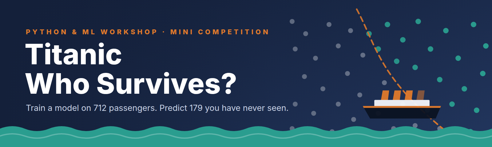

# Codabench mini competition: Titanic · Who Survives?



The closing challenge of the workshop: students train a model on 712 Titanic
passengers, predict 179 unseen ones, and upload to a live Codabench
leaderboard.

## Upload it (5 minutes)

1. Sign in at **<https://www.codabench.org>**.
2. **Benchmarks → Management → Upload** and choose
   **`dist/titanic-who-survives_bundle.zip`**.
3. When the upload finishes, open the competition, check the pages, and
   **publish** it (Edit → *Publish*), or share the secret link with the class.
4. Test it yourself: upload **`dist/example_submission.zip`** under *My
   Submissions*. It should score **0.7765** and show the detailed report
   (preview: [`dist/example_detailed_results.html`](dist/example_detailed_results.html)).
5. Put the competition URL on the *mini competition* slide and in the chat.

## What's inside

```
codabench/
├── build_bundle.py            regenerates data, starting kit and the zip; self-tests the scorer
├── assets/                    logo + banner (SVG sources and PNGs); the pages link banner.png from GitHub
├── bundle/                    exactly what goes in the zip
│   ├── competition.yaml       title, dates, phase, leaderboard (accuracy · balanced accuracy · F1)
│   ├── logo.png
│   ├── pages/                 Overview · Data · Evaluation · How to submit · Terms (styled HTML)
│   ├── input_data/            PUBLIC: train.csv (712), test.csv (179), sample_submission.csv
│   ├── reference_data/        HIDDEN: test_labels.csv (answer key + Sex, Pclass for the report)
│   ├── scoring_program/       score.py (stdlib only) + metadata
│   └── starting_kit/          starting_kit.ipynb, baseline.py, the data
└── dist/
    ├── titanic-who-survives_bundle.zip   ← upload this
    ├── example_submission.zip            a valid submission (the baseline)
    └── example_detailed_results.html     what students see after submitting
```

## Settings worth knowing

| setting | value | where |
|---|---|---|
| opens | Wed 11 Nov 2026, 09:00 Dubai (05:00 UTC) | `competition.yaml → phases.start` |
| closes | Thu 19 Nov 2026, 00:00 Dubai | `phases.end` |
| submissions | 10 per day, 60 total, results only (a zipped CSV) | `phases` |
| ranking | accuracy; balanced accuracy and F1 shown alongside | `leaderboards` |
| leaderboard rule | each participant's best submission (`Force_Best`) | `leaderboards.submission_rule` |
| split | stratified, `random_state=2026` | `build_bundle.py` |

| reference score on the hidden test set | accuracy |
|---|---|
| nobody survived | 0.6145 |
| only women survived | 0.7821 |
| starting-kit logistic regression | 0.7765 |

The starting kit's model deliberately loses to the one-rule baseline: the
lesson is that features (title from the name, family size, cabin…) matter more
than the algorithm.

## Changing something

Edit the files in `bundle/` (or the data split in `build_bundle.py`), then:

```bash
python codabench/build_bundle.py
```

It rewrites the data and the starting kit, re-runs the scorer on three
reference submissions, and rebuilds the zip. To change a running competition,
edit it in the Codabench UI (pages, dates) or upload the new bundle as a new
competition.

## The scorer

`score.py <input> <output>` reads the participant's CSV from `input/res/` and
the answer key from `input/ref/`, then writes:

- `scores.json`: `accuracy`, `balanced_accuracy`, `f1`, `precision`, `recall`
- `detailed_results.html`: score, confusion matrix, baselines, accuracy by sex and class

It is forgiving about format (any CSV name, `;` or `,`, `True/False` or
`0.0/1.0`) and strict about content: a missing passenger, a duplicate or a
probability fails the submission with a message that says exactly what to fix.

> The Titanic passenger list is public, so the answer key could be looked up.
> This competition runs on the honour code stated in its Terms.
