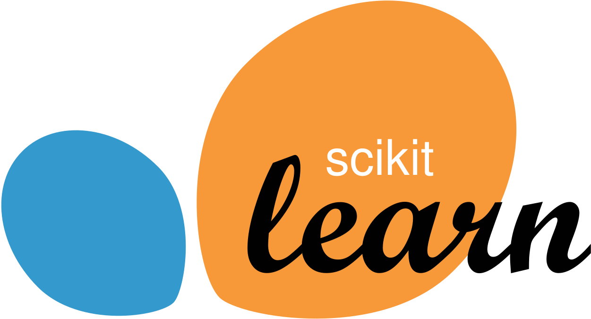
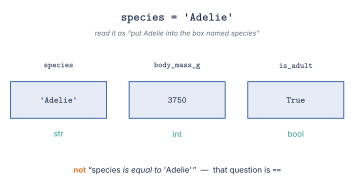
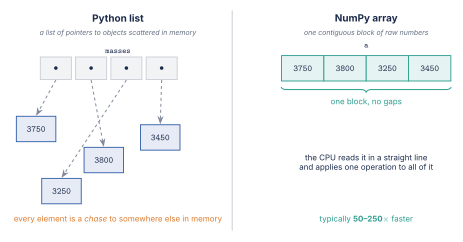
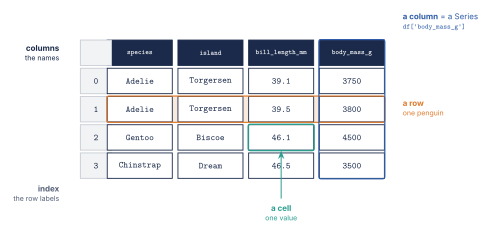
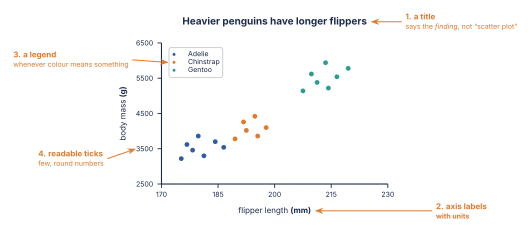
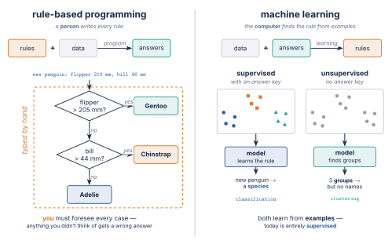
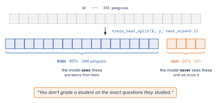
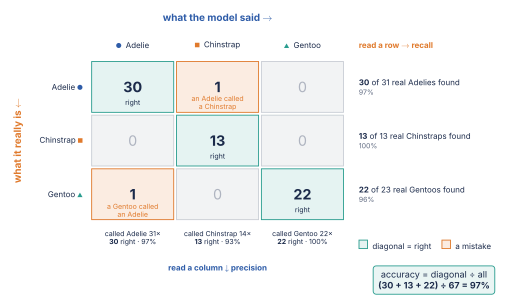
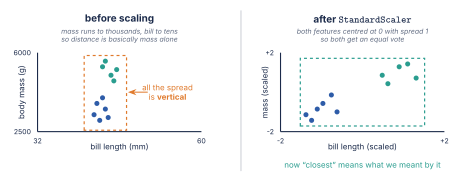
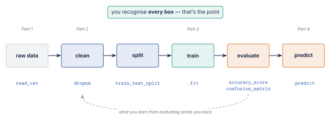

## Where we're going {.center}

Today you will train a machine learning model that classifies penguins by
species, then a model that predicts their weight, and then you will do it
again, alone, on the Titanic.

::: {.fragment}
No installs. Just a browser. And at the end, a **mini competition** with a live leaderboard.
:::

::: {.notes}
Same four steps as the long workshop, same notebooks, less talking. The rule
for the whole session: show the idea, let them touch it (the interactive
slides), type the code, move on. Open NB1 and run cell 1 before anything else.
:::

---

## The journey

| | part | what you will do |
|---|---|---|
| **01** | Python for data | variables → **NumPy** → **pandas** |
| **02** | Explore & visualise | missing values, groupby, **Matplotlib** charts |
| **03** | Your first models | **scikit-learn** · classification vs regression · linear & logistic regression |
| **04** | Compare & challenge | KNN, scaling, the Titanic, the **Codabench** competition |

::: {.fragment}
👍 **thumbs up**: done · ✋ **flat hand**: stuck. Use both, all session.
:::

::: {.notes}
Two notebooks: NB1 for Parts 1–2, NB2 for Parts 3–4. NB2 loads its own clean
data in cell 1, so a broken NB1 never blocks the ML part. Say that out loud —
it removes a real anxiety.
:::

---

## Your toolkit {.smaller}

::: {.libgrid}
::: {.lib}


**NumPy** · fast maths on whole arrays of numbers
:::
::: {.lib}


**pandas** · tables with named columns: load, clean, filter
:::
::: {.lib}


**Matplotlib** · turn numbers into pictures
:::
::: {.lib}


**scikit-learn** · machine learning in four verbs
:::
:::

::: {.keypoint}
Each one stands on the one before it. We meet them in that order, each at the moment we need it.
:::

::: {.notes}
Thirty-second preview, not a lecture. Point at the stack: scikit-learn is
built on NumPy, pandas is built on NumPy, Matplotlib draws NumPy arrays.
Each library gets its own "why" slide when it first appears.
:::

---

## Before anything else {.center background-color="#2A9D8F" background-gradient="linear-gradient(135deg, #2A9D8F 0%, #1F7A70 100%)"}

Open **NB1**. Click **Copy to Drive**. Run cell 1.

You should see a table of penguins.

::: {.fragment .keypoint}
Stuck later? **Runtime → Restart and run all.** You cannot break anything.
:::

::: {.notes}
First win, fast. Only Shift+Enter, the runtime indicator and Restart & run
all — nothing else about Colab matters today.
:::

---

## Part 1 · Python for data {.part .center background-color="#1B2A4A" background-gradient="linear-gradient(135deg, #14203A 0%, #22365E 100%)"}

::: {.part-num}
01
:::

::: {.part-goal}
<span>GOAL</span> you will be filtering a real table of 344 penguins
:::

---

## Values, names and types {.smaller}

::: {.columns}
::: {.column width="55%"}
{width="100%"}
:::
::: {.column width="45%"}
| you write | type |
|---|---|
| `'Adelie'` | `str`: text, in quotes |
| `3750` | `int` |
| `39.1` | `float` |
| `True` | `bool` |
:::
:::

::: {.keypoint}
`=` puts a value in a box. `==` asks a question.
:::

---

## Every value has a type {.widget-slide}

<iframe class="widget" src="../assets/interactive/types-sort.html" height="560"></iframe>

::: {.notes}
Call students up to drag, or let the room shout the bin. The three traps are
deliberate: '3750' (quotes win → str), 3.0 (the dot → float) and 'True'
(quotes → str). Ask "how would Python tell you?" → type(...), next slide.
:::

---

## Change a value, break a value {.smaller}

::: {.columns}
::: {.column width="40%"}
Every line here is live. Change a number, change a word, press **Run**.

::: {.fragment}
Now delete the quotes around `'Adelie'` and run it again. Read the error:
you will see that one a lot today.
:::
:::
::: {.column width="60%"}
```{pyodide}
#| edit: true
#| runbutton: true
species     = 'Adelie'
body_mass_g = 3750
is_adult    = True

print(species, 'weighs', body_mass_g, 'g')
print(type(species), type(body_mass_g))
```
:::
:::

::: {.notes}
Take one suggestion from the room and type it. Keep it short — the real
practice is in the notebook; this keeps the room awake and makes errors feel
survivable early. First run downloads Python into the browser (~10 s).
:::

---

## Lists by position, dicts by name {.smaller}

::: {.columns}
::: {.column width="50%"}
```python
masses = [3750, 3800, 3250, 3450]
masses[0]     # 3750: counts from 0
masses[-1]    # 3450: from the end
masses[:2]    # [3750, 3800]
len(masses)   # 4
```
A column of a table is a list.
:::
::: {.column width="50%"}
```python
penguin = {'species': 'Adelie',
           'mass': 3750,
           'island': 'Torgersen'}
penguin['mass']   # 3750
```
A row of a table is a dict.
:::
:::

::: {.notes}
Zero-indexing is the one thing worth stopping on here. Everything else is in
the notebook.
:::

---

## What a loop actually does {.clip-slide}

<div class="clip">
<video src="../assets/rendered/asset_03_for_loop.mp4" autoplay muted playsinline preload="metadata"></video>
<button class="replay">&#8635; replay</button>
</div>

::: {.notes}
Self-contained: the code, a pointer walking the list, m taking each value,
total growing to 14250. Don't talk over it. Then ask: "if the list had 344
masses, how many times would the indented line run?" (344)
:::

---

## One item at a time {.widget-slide}

<iframe class="widget" src="../assets/interactive/loop-stepper.html" height="540"></iframe>

::: {.notes}
Press Step slowly and let the room predict each next value of total before you click. The orange arrow is
the line Python is running. Ask at the end: how many times did line 4 run? (4, once per item.)
:::

---

## Loops, choices, functions {.smaller}

::: {.columns}
::: {.column width="50%"}
```python
for m in masses:
    if m > 3700:
        print(m, 'heavy')
    else:
        print(m, 'light')
```
The **indent** is the syntax: four spaces means "inside".
:::
::: {.column width="50%"}
```python
def size_label(mass_g):
    return ('large' if mass_g > 3700
            else 'small')

size_label(3750)    # 'large'
```
`def` names a piece of work. Calling it runs it.
:::
:::

---

## Meet NumPy {.smaller .libintro}

::: {.columns}
::: {.column width="34%"}
{.liblogo}

```python
import numpy as np
```
:::
::: {.column width="66%"}
### Why it matters, right now

- A Python list is a row of separate boxes: looping over 1 000 000 of them is **slow**.
- A NumPy **array** is one block of numbers, processed in fast compiled code: **one operation hits every element**.
- Every number in machine learning (features, weights, predictions) lives in a NumPy array.
- **pandas, Matplotlib and scikit-learn are all built on top of it.**
:::
:::

::: {.keypoint}
Lists are for storing things. Arrays are for doing maths on them.
:::

::: {.notes}
This is the moment the room needs to know why a second way to hold numbers
exists. The next slide proves the speed claim; the one after shows
vectorisation.
:::

---

## Why NumPy? Speed {.smaller .nostretch}

{width="58%" fig-align="center"}

```python
big = np.random.rand(1_000_000)
%timeit sum(big)      # milliseconds
%timeit big.sum()     # microseconds: 50–250× faster
```

::: {.notes}
Run the %timeit live in the notebook. The "why not a list" question is gone
for good.
:::

---

## "Vectorised" means no loop {.clip-slide}

<div class="clip">
<video src="../assets/rendered/asset_05_broadcasting.mp4" autoplay muted playsinline preload="metadata"></video>
<button class="replay">&#8635; replay</button>
</div>

::: {.notes}
The 2 is stretched to the array's shape, every pair multiplied at once, then
a > 3700 gives one True/False per element. Ask: "what would a + 100 give?" —
then the live cell lets them check.
:::

---

## One operation, every element {.smaller}

```python
a = np.array([3750, 3800, 3250, 3450])

a * 2            # no loop: [7500 7600 6500 6900]
a.mean()         # 3562.5
a > 3700         # [ True  True False False]: one answer per element
a[a > 3700]      # [3750 3800]: keep only the True ones
(a > 3700).sum() # 2: True counts as 1
```

::: {.keypoint}
That mask is exactly how you will filter a table.
:::

---

## No loop, every element {.smaller}

::: {.columns}
::: {.column width="40%"}
No loop anywhere. Change `* 2` to `+ 100`, or the threshold to `4000`.

::: {.fragment}
Print `masses > 3700` on its own to see the mask itself.
:::
:::
::: {.column width="60%"}
```{pyodide}
#| edit: true
#| runbutton: true
import numpy as np

masses = np.array([3750, 3800, 3250, 3450, 4100])

print(masses * 2)
print(masses.mean())
print(masses[masses > 3700])
print((masses > 3700).sum(), "above 3700")
```
:::
:::

::: {.notes}
The mask is the bridge to pandas filtering in a few slides — say so.
:::

---

## Meet pandas {.smaller .libintro}

::: {.columns}
::: {.column width="34%"}
{.liblogo}

```python
import pandas as pd
df = pd.read_csv('penguins.csv')
```
:::
::: {.column width="66%"}
### Why it matters, right now

- Real data is a **table**: named columns, mixed types (text, numbers), missing cells. A bare array can't hold that.
- pandas reads a CSV, an Excel file or a database in **one line**.
- It answers questions in one line too: *filter*, *sort*, *group*, *count*, *fill the gaps*.
- Under every column is a NumPy array, so the speed (and the masks) come with it.
:::
:::

::: {.keypoint}
pandas is where data science happens: 80% of a real project is getting the table right.
:::

::: {.notes}
"Spreadsheet you can program" is the one-line pitch. The mask they just met
in NumPy is literally how pandas filters rows; two slides from now they drag
a threshold and watch it happen.
:::

---

## A DataFrame is a spreadsheet you can program

{width="80%" fig-align="center"}

---

## Selecting and filtering {.smaller}

| you write | you get |
|---|---|
| `df['body_mass_g']` | one column → a **Series** |
| `df[['species', 'body_mass_g']]` | a list of columns → a **DataFrame** |
| `df[df['body_mass_g'] > 4500]` | the rows where the mask is `True` |
| `df[(df.species == 'Gentoo') & (df.body_mass_g > 5000)]` | two conditions |

::: {.keypoint}
`&` not `and`, and **parentheses around each condition**.
:::

::: {.notes}
Single vs double brackets causes the most common error in the ML part — flag
it now.
:::

---

## A mask keeps the True rows {.widget-slide}

<iframe class="widget" src="../assets/interactive/mask-filter.html" height="560"></iframe>

::: {.notes}
Drag the slider slowly from 2800 to 6200: rows fade out as their mask flips
to False. Then click "Gentoo" and show the code line grow an & condition with
parentheses — exactly the rule on the previous slide.
:::

---

## Exercise 1 {background-color="#E07A2C" background-gradient="linear-gradient(135deg, #E07A2C 0%, #C4601A 100%)"}

**NB1 → Exercise 1.** Fill the blanks.

1. A function that labels a flipper `'long'` or `'short'`
2. Count the penguins above the mean mass
3. Count the Chinstraps

::: {.notes}
Circulate, do not present. If a third of the room is still on task 1, stop
and do it together on screen.
:::

---

## Checkpoint {.center}

```python
df[df['body_mass_g'] > 4000].shape[0]
```

A penguin, a number, or a table?

::: {.fragment .keypoint}
A number: the count of penguins over 4000 g.
:::

---

## Part 2 · Explore & visualise {.part .center background-color="#1B2A4A" background-gradient="linear-gradient(135deg, #14203A 0%, #22365E 100%)"}

::: {.part-num}
02
:::

::: {.part-goal}
<span>GOAL</span> you will have made the chart the rest of the workshop depends on
:::

---

## The first three questions {.smaller}

| question | the line |
|---|---|
| What do the numbers look like? | `df.describe()` |
| How many of each category? | `df['species'].value_counts()` |
| What is missing? | `df.isna().sum()` |

::: {.keypoint}
Run all three on any new dataset, before anything else.
:::

---

## Missing values are a decision {.smaller}

| option | what it costs you |
|---|---|
| **drop the rows**: `df.dropna()` | data; and dropped rows are rarely random |
| **fill with a constant** | invents a value that may be nonsense |
| **fill with the median** (*imputation*) | keeps rows, shrinks the spread |

On the Titanic, a median fill puts 177 people at age 28: the 25–30 bin goes
from **106 → 283**.

::: {.keypoint}
You are not recovering the value. You are inventing one, so fit it on train
only, and record what you filled.
:::

::: {.notes}
Ask the room what dropna loses before running it (11 of 344 — cheap here).
The Titanic numbers are what they will produce themselves in the challenge.
:::

---

## What filling actually does {.clip-slide}

<div class="clip">
<video src="../assets/rendered/asset_20_imputation.mp4" autoplay muted playsinline preload="metadata"></video>
<button class="replay">&#8635; replay</button>
</div>

::: {.notes}
Real Titanic ages: 177 missing, all filled with the median 28, the 25–30 bar
jumps 106 → 283, the spread shrinks 14.5 → 13.0. Ask: "is that shrinkage a
problem for a model?" — they meet it again in the Titanic challenge.
:::

---

## Every way of filling changes the data {.widget-slide}

<iframe class="widget" src="../assets/interactive/impute-playground.html" height="540"></iframe>

::: {.notes}
Click through the strategies in order. Median: the 25–30 bar jumps by 177 and the spread shrinks (the
numbers from the clip). Zero: the mean collapses. Sampling real ages keeps the shape. Ask: which would you
choose for the Titanic challenge, and why?
:::

---

## Split, apply, combine: in motion {.clip-slide}

<div class="clip">
<video src="../assets/rendered/asset_08_split_apply_combine.mp4" autoplay muted playsinline preload="metadata"></video>
<button class="replay">&#8635; replay</button>
</div>

::: {.notes}
Real rows split by species, each group collapses to its mean, the means form
a new table. Ask: "what would .max() change?" (the apply step only).
:::

---

## Group, then summarise {.widget-slide}

<iframe class="widget" src="../assets/interactive/groupby-playground.html" height="520"></iframe>

::: {.notes}
Press the button three times: split (rows go to their species), apply (each bucket becomes one number),
combine (a new three-row table). Then switch .mean() to .max() or .count(): only the apply step changes.
:::

---

## Split, apply, combine {.smaller}

```python
df.groupby('species')['body_mass_g'].mean()
```

| part | what it does |
|---|---|
| `groupby('species')` | **split**: one bucket per species |
| `['body_mass_g']` | the column to summarise |
| `.mean()` | **apply**: each bucket to one number |
| *(result)* | **combine**: one row per group |

---

## Meet Matplotlib {.smaller .libintro}

::: {.columns}
::: {.column width="34%"}
{.liblogo}

```python
import matplotlib.pyplot as plt
import seaborn as sns   # built on it
```
:::
::: {.column width="66%"}
### Why it matters, right now

- A table of 344 rows hides its patterns. A **picture shows them in a second**: groups, trends, outliers, data errors.
- Matplotlib is Python's base plotting library: every chart, in every notebook, in every paper.
- **seaborn** sits on top of it and makes statistical charts (colour by group, in one line) with nicer defaults.
- Before you train a model, you **look**. The chart tells you whether a model even has a chance.
:::
:::

::: {.keypoint}
Never model data you haven't plotted.
:::

::: {.notes}
Why now: we have summaries (describe, groupby); numbers alone cannot show a
shape. Next slide is how to make a chart readable; the slide after is the
chart the whole ML part depends on.
:::

---

## Charts: label them {.smaller}

{width="70%" fig-align="center"}

histogram → one variable · scatter → two · scatter + colour → a third

---

## The hinge of the whole workshop {.smaller}

::: {.columns}
::: {.column width="50%"}
```python
sns.scatterplot(
    data=df,
    x='flipper_length_mm',
    y='body_mass_g')
```
A cloud.
:::
::: {.column width="50%"}
```{.python code-line-numbers="5"}
sns.scatterplot(
    data=df,
    x='flipper_length_mm',
    y='body_mass_g',
    hue='species')
```
**Three groups.**
:::
:::

::: {.fragment .keypoint}
Those groups are what a classifier learns to draw a line between.
:::

::: {.notes}
The one sentence you must not skip. Say it slowly. Also point at the left
chart: the cloud slopes upward — longer flippers, heavier penguins. Part 3
draws the best straight line through it (linear regression).
:::

---

## Practice {background-color="#E07A2C" background-gradient="linear-gradient(135deg, #E07A2C 0%, #C4601A 100%)"}

**NB1 → Independent practice.** Questions 1–3, in pairs.

1. Which species is heaviest on average?
2. How many penguins on each island?
3. Do flipper length and mass move together? Show it.

::: {.notes}
Question 4 (the open chart) is homework. Question 3 is the setup for Part 3:
whatever they draw, they will put a line through it (linear regression)
after the break.
:::

---

## Break {background-color="#2A9D8F" background-gradient="linear-gradient(135deg, #2A9D8F 0%, #1F7A70 100%)" .center}

Open **NB2** and run cell 1 before you stand up.

---

## Part 3 · Your first models {.part .center background-color="#1B2A4A" background-gradient="linear-gradient(135deg, #14203A 0%, #22365E 100%)"}

::: {.part-num}
03
:::

::: {.part-goal}
<span>GOAL</span> you will have trained and scored a regression model and a classifier
:::

---

## Machine learning in one slide {.smaller .nostretch .fullfig}

{fig-align="center"}

::: {.notes}
Left first: this is how all software worked before ML — a person types every
rule, and every case they did not foresee is wrong (ask: "what about a small
Gentoo with 200 mm flippers?"). Then the right: same penguins, but we hand
over examples WITH answers and the computer finds the rule — that is
supervised learning, and it is all we do today. Unsupervised (no answers,
it only finds groups) is there so they know the word.
:::

---

## Meet scikit-learn {.smaller .libintro}

::: {.columns}
::: {.column width="34%"}
{.liblogo}

```python
from sklearn.linear_model import (
    LinearRegression)
model = LinearRegression()
```
:::
::: {.column width="66%"}
### Why it matters, right now

- Dozens of algorithms (linear regression, logistic regression, KNN, trees…), **all with the same four verbs**: `fit`, `predict`, `score`, `transform`.
- Learn the pattern once, swap the algorithm in **one line**.
- The tools around the model are included: `train_test_split`, scalers, metrics, the confusion matrix.
- Free, tested, and used in industry and research. It takes **NumPy arrays and pandas tables** directly.
:::
:::

::: {.keypoint}
In scikit-learn, every model is used the same way. That is why we can meet three of them today.
:::

::: {.notes}
This is why the rest of the workshop is possible in the time we have. Point
at the import: the module tells you the family (linear_model, neighbors,
metrics, preprocessing).
:::

---

## Two kinds of question: classification vs regression {.smaller}

::: {.columns .cards .twocards}
::: {.column}
### 🏷️ Classification
The answer is a **category** from a fixed list.

*Which species is this penguin?* · *Did this passenger survive?*

**Output** a label (`'Gentoo'`, `0`/`1`) · **Scored by** accuracy, the confusion matrix

**Today:** logistic regression · KNN
:::
::: {.column}
### 📈 Regression
The answer is a **number** on a scale.

*How heavy is this penguin?* · *What will this flat sell for?*

**Output** a quantity (`4 158 g`) · **Scored by** average error (MAE), R²

**Today:** linear regression
:::
:::

::: {.keypoint}
Same data, two questions. Predict `species` → classification. Predict `body_mass_g` → regression.
:::

::: {.notes}
The test: "is being off by a little meaningful?" Predicting 4100 g for a
4150 g penguin is nearly right; predicting Chinstrap for a Gentoo is just
wrong. That is why they need different scores. Same split → fit → predict →
score shape for both.
:::

---

## Category or number? {.widget-slide}

<iframe class="widget" src="../assets/interactive/class-vs-reg.html" height="560"></iframe>

::: {.notes}
Take votes from the room before each drag. The digit card is the trap: the
answer is a number but it is a category (no "closer" wrong answer). The bus
card is the opposite: minutes have an order and a distance → regression.
:::

---

## Features, labels, and the split {.smaller}

::: {.columns}
::: {.column width="45%"}
```python
X = df[['flipper_length_mm',
        'body_mass_g',
        'bill_length_mm']]  # features
y = df['species']           # label
```
`X` double brackets, `y` single.
:::
::: {.column width="55%"}
{width="100%"}
:::
:::

::: {.keypoint}
You don't grade a student on the questions they studied.
:::

::: {.notes}
y = species → classification. If y were body_mass_g (and mass left out of
X), the very same code would set up a regression.
:::

---

## Which column is the answer? {.widget-slide}

<iframe class="widget" src="../assets/interactive/features-labels.html" height="520"></iframe>

::: {.notes}
Do the species question first: species to y, measurements to X. Then drag species into X to show the
leakage warning. Switch to 'How heavy is it?': body_mass_g moves to y and species can now be a feature.
The same table gives a classification or a regression depending on y.
:::

---

## The split, in motion {.clip-slide}

<div class="clip">
<video src="../assets/rendered/asset_12b_train_test_split.mp4" autoplay muted playsinline preload="metadata"></video>
<button class="replay">&#8635; replay</button>
</div>

::: {.notes}
333 penguins shuffled, 266 train / 67 test, the model learns from train only
and sits the exam on test (0.97). Ask: "why shuffle first?"
:::

---

## Where the penguins go {.widget-slide}

<iframe class="widget" src="../assets/interactive/split-playground.html" height="520"></iframe>

::: {.notes}
Slide test_size from 0.1 to 0.5: fewer penguins to learn from vs a more reliable exam. Re-roll the seed at
0.1 and watch the species mix of the test set jump around. Turn on stratify: the mix is identical on
both sides. random_state=42 is what makes your split reproducible.
:::

---

## Underfit, good fit, overfit {.clip-slide}

<div class="clip">
<video src="../assets/rendered/asset_13_overfitting.mp4" autoplay muted playsinline preload="metadata"></video>
<button class="replay">&#8635; replay</button>
</div>

::: {.notes}
Three models on the same 11 points, then 10 new points. Errors are computed on
screen: overfit 0.00 on training but the worst (0.11) on new points. Ask:
"which number would you report to your boss?" (new points). Next slide: they
drive the complexity themselves.
:::

---

## More complex is not always better {.widget-slide}

<iframe class="widget" src="../assets/interactive/overfit-slider.html" height="560"></iframe>

::: {.notes}
Slide the degree from 0 to 11 slowly. Training error (blue) only ever goes
down; error on new points (orange) goes down, then back up — the U. Hit "New
unseen points" at degree 11: the wiggly curve is wrong in new ways each time.
:::

---

## Which would you trust? {.smaller}

| | on the training data | on a penguin it has never seen |
|---|---|---|
| **underfit** | poor | poor |
| **good fit** | good | **good** |
| **overfit** | *perfect* | poor |

::: {.keypoint}
A model that memorised scores brilliantly and is useless on the next penguin.
The test set is the only column that counts.
:::

---

## Algorithm 1 · Linear regression {.part .center background-color="#1B2A4A" background-gradient="linear-gradient(135deg, #14203A 0%, #22365E 100%)"}

::: {.part-goal}
<span>REGRESSION</span> predict a penguin's body mass (a number) from its flipper length
:::

---

## Linear regression: the best straight line {.smaller}

$$\hat{y} = w\,x + b \qquad\qquad \text{MSE} = \frac{1}{n}\sum_{i=1}^{n}\left(y_i - \hat{y}_i\right)^2$$

::: {.columns}
::: {.column width="55%"}
- $x$: the feature (flipper length), $\hat{y}$: the prediction (mass)
- $w$, the **slope**: grams gained per extra mm of flipper
- $b$, the **intercept**: where the line starts
- $y_i - \hat{y}_i$, the **residual**: how far each penguin is from the line
:::
::: {.column width="45%"}
`.fit()` searches for the $w$ and $b$ that make the **mean squared error** as small as possible ("least squares").

Squaring makes every error positive, and punishes big misses much more than small ones.
:::
:::

::: {.keypoint}
Two numbers, $w$ and $b$, are the whole model.
:::

::: {.notes}
Point at the residual: it is the orange vertical line in the next widget.
Don't derive anything; the widget shows that "best" means "smallest total
squared residual".
:::

---

## The best line has the smallest errors {.widget-slide}

<iframe class="widget" src="../assets/interactive/linreg-playground.html" height="560"></iframe>

::: {.notes}
Real penguins, all 333. Invite a student to drag the two handles and get the
MAE as low as they can. Then press "Let .fit() find it" and compare: the
machine's line lands around 50 g per mm. Use the probe slider: a 200 mm
flipper → about 4 160 g.
:::

---

## split → fit → predict → score, for a number {.smaller}

```{.python code-line-numbers="|1-4|6-7|9|10-12"}
from sklearn.linear_model import LinearRegression
X = df[['flipper_length_mm']];  y = df['body_mass_g']
X_train, X_test, y_train, y_test = train_test_split(
    X, y, test_size=0.2, random_state=42)

reg = LinearRegression().fit(X_train, y_train)
reg.coef_, reg.intercept_      # w ≈ 50.4 g per mm, b ≈ −5919

preds = reg.predict(X_test)    # 67 masses, in grams
mean_absolute_error(y_test, preds)   # ≈ 290 g off, on average
r2_score(y_test, preds)              # ≈ 0.79
```

::: {.keypoint}
Same four steps as any model. Only the **score** changed: there is no "accuracy" for a number.
:::

::: {.notes}
Read the coefficient out loud as a sentence: "each extra millimetre of
flipper adds about 50 grams." That interpretability is linear regression's
superpower. Baseline: always guessing the mean mass is ~674 g off, so 290 g
is a real improvement.
:::

---

## How good is a regression? {.smaller}

| score | what it means | ours |
|---|---|---|
| **MAE**: mean absolute error | on average, how many grams off | **290 g** |
| **RMSE**: root mean squared error | like MAE, but big misses count more | 360 g |
| **R²** | share of the variation the model explains (1 = perfect, 0 = no better than the mean) | **0.79** |
| *baseline*: always predict the mean | the number to beat | 674 g |

::: {.columns}
::: {.column width="50%"}
**More features → a better line:**

```python
X = df[['flipper_length_mm', 'is_male', 'is_gentoo']]
```
:::
::: {.column width="50%"}
MAE **290 → 209 g**, R² **0.79 → 0.88**.

$\hat{y} = w_1x_1 + w_2x_2 + w_3x_3 + b$: one weight per feature.
:::
:::

::: {.notes}
Multiple linear regression is the same idea with one weight per column. Sex
and species carry information that flipper length doesn't: a male penguin is
~545 g heavier at the same flipper length. RMSE value: computed on the same
split.
:::

---

## Predicting a penguin's mass, live {.smaller}

::: {.columns}
::: {.column width="40%"}
A real linear regression, live. Press **Run**.

::: {.fragment}
Add `'bill_depth_mm'` or `'is_male'` to `features`. Does the error go down?
:::

::: {.fragment}
Read `w`: how many grams per unit of each feature?
:::
:::
::: {.column width="60%"}
```{pyodide}
#| edit: true
#| runbutton: true
import pandas as pd
from sklearn.model_selection import train_test_split
from sklearn.linear_model import LinearRegression
from sklearn.metrics import mean_absolute_error, r2_score

df = pd.read_csv("data/penguins.csv").dropna()
df['is_male'] = (df['sex'] == 'MALE').astype(int)

features = ['flipper_length_mm']        # <- add more
X, y = df[features], df['body_mass_g']
X_train, X_test, y_train, y_test = train_test_split(
    X, y, test_size=0.2, random_state=42)

reg = LinearRegression().fit(X_train, y_train)
p = reg.predict(X_test)
print("w =", reg.coef_.round(1), " b =", round(reg.intercept_))
print(f"MAE = {mean_absolute_error(y_test, p):.0f} g   R² = {r2_score(y_test, p):.3f}")
```
:::
:::

::: {.notes}
The first run fetches scikit-learn into the browser — run it once before the
session so it is cached. Adding is_male: MAE 290 → 257 g.
:::

---

## Algorithm 2 · Logistic regression {.part .center background-color="#1B2A4A" background-gradient="linear-gradient(135deg, #14203A 0%, #22365E 100%)"}

::: {.part-goal}
<span>CLASSIFICATION</span> the same weighted sum as linear regression, squashed into a probability
:::

---

## split → fit → predict → score {.smaller}

```{.python code-line-numbers="|1-2|4-5|7|8"}
X_train, X_test, y_train, y_test = train_test_split(
    X, y, test_size=0.2, random_state=42)

model = LogisticRegression(max_iter=1000)
model.fit(X_train, y_train)            # it learns here

preds = model.predict(X_test)          # 67 unseen penguins
accuracy_score(y_test, preds)          # 0.97
```

::: {.keypoint}
Every model you ever meet uses this same four-step shape.
:::

::: {.notes}
Back to y = species. Walk the highlight with the arrow keys, typing along in
NB2. Pause on .fit(). Compared to the regression slide: only the model class
and the score changed. random_state is reproducibility; test_size=0.2 holds
back 20% for the exam.
:::

---

## What fitting looks like {.clip-slide}

<div class="clip">
<video src="../assets/rendered/asset_14_decision_boundary.mp4" autoplay muted playsinline preload="metadata"></video>
<button class="replay">&#8635; replay</button>
</div>

::: {.notes}
Real penguins: the boundaries start as a random guess (23% correct) and
gradient steps move them to 95%. Ask: "why does it stop improving?" (the
classes genuinely overlap).
:::

---

## What the model actually computes {.clip-slide}

<div class="clip">
<video src="../assets/rendered/asset_22_logistic_curve.mp4" autoplay muted playsinline preload="metadata"></video>
<button class="replay">&#8635; replay</button>
</div>

::: {.notes}
Weighted sum → score z → sigmoid → probability, with a live readout sweeping
z. Ask: "what p does z = 0 give?" (0.5 — the boundary). The next slide has
the two equations to copy.
:::

---

## What `.fit()` learned {.smaller}

$$z = w_1x_1 + w_2x_2 + w_3x_3 + b \qquad\qquad p = \frac{1}{1 + e^{-z}}$$

- $x$ are the features, $w$ how much each one counts, $b$ an offset
- $z$ is **exactly a linear regression**; the sigmoid squashes it into a probability between 0 and 1
- `.fit()` is the search for good $w$ and $b$, nothing more

::: {.keypoint}
`model.predict_proba(X_test)` shows the probabilities. A 0.51 and a 0.99 are
both "Gentoo", so don't treat them the same.
:::

---

## From a score to a probability {.widget-slide}

<iframe class="widget" src="../assets/interactive/sigmoid-playground.html" height="560"></iframe>

::: {.notes}
One feature (body mass), one yes/no question (Gentoo?). The boundary slider
moves the p = 0.5 point; steepness w sets how sure the model gets. Steep +
wrong boundary → log-loss explodes: confidently wrong is worst. Then press
"Let .fit() find it".
:::

---

## Which mistakes? The confusion matrix {.clip-slide}

<div class="clip">
<video src="../assets/rendered/asset_23_confusion_matrix.mp4" autoplay muted playsinline preload="metadata"></video>
<button class="replay">&#8635; replay</button>
</div>

::: {.notes}
Built from the deck's real 67 test predictions: each penguin lands in row =
what it really is, column = what the model said. The diagonal is every
correct answer, (30 + 13 + 22) / 67 = 97%; each orange cell names one
mistake — 1 Adelie called a Chinstrap, 1 Gentoo called an Adelie. Ask: "if
the rows were sick / healthy patients, which off-diagonal cell would worry
you most?"
:::

---

## Reading the confusion matrix {.smaller .nostretch .fullfig}

{fig-align="center"}

::: {.notes}
The same matrix the clip just built — real numbers, same split. Walk it in
this order: (1) the teal diagonal is every right answer → 65/67 = 97%;
(2) the two orange cells name the mistakes; (3) read a ROW to ask "of the
real Gentoos, how many did it find?" (recall, 22/23); (4) read a COLUMN to
ask "when it says Chinstrap, how often is it right?" (precision, 13/14).
In NB2: ConfusionMatrixDisplay.from_estimator(model, X_test, y_test).
:::

---

## The threshold chooses your mistakes {.widget-slide}

<iframe class="widget" src="../assets/interactive/threshold-matrix.html" height="560"></iframe>

::: {.notes}
Real Titanic passengers, the same kind of model they will build in the
challenge. Default threshold 0.5. Drag it down to 0.2: recall jumps, false
alarms pile up. Drag it to 0.8: almost no false alarms, many missed
survivors. Accuracy barely changes while the kinds of mistake swap — that is
why one number is never enough.
:::

---

## What to look at in the errors {.smaller}

::: {.columns .cards .errcards}
::: {.column}
### 🔍 Which pairs get confused?
Off-diagonal cells name them: **Adelie → Chinstrap** and **Gentoo → Adelie**, the species that overlap in size.
:::
::: {.column}
### 📏 Read each row: *recall*
Of the real Gentoos, how many did it find? **22 / 23**. A class can look fine overall and still be missed.
:::
::: {.column}
### 🎯 Read each column: *precision*
When it says "Chinstrap", how often is it right? **13 / 14**: one false alarm.
:::
:::

::: {.columns .cards .errcards}
::: {.column}
### ⚖️ Watch the small classes
Only **13** Chinstraps in the test set: one mistake costs 7 points of recall. Overall accuracy hides it.
:::
::: {.column}
### 🩺 Ask what each mistake costs
A swapped penguin is harmless; a **missed tumour** is not. Judge a model by the mistake you can least afford.
:::
::: {.column}
### 🐧 Open the wrong rows
`X_test[preds != y_test]` → a **3950 g** Gentoo, a **41 mm**-bill Adelie: genuinely on a boundary, not a bug.
:::
:::

```python
from sklearn.metrics import classification_report
print(classification_report(y_test, preds))   # recall + precision for every class
```

::: {.notes}
Six habits, not six formulas. Spend the time on the cost question (🩺):
in medicine, a missed cancer (false negative) and a false alarm (false
positive) are not equal — that is why doctors tune for recall. Then run the
two lines in NB2 and look at the two wrong penguins together.
:::

---

## Checkpoint: which model would you trust? {.smaller}

Two models trained on the **same 266 penguins**, then scored on the **67 they never saw**:

| | on the training penguins | on the 67 unseen penguins | gap |
|---|---|---|---|
| **Model A**: logistic regression | 98.1% | **97.0%** | 1 point |
| **Model B**: 1-nearest-neighbour, raw units | **100%** | 80.6% | **19 points** |

::: {.fragment}
Model B is *perfect* on the penguins it studied, because it **memorised** them.
On new penguins it falls apart. That is **overfitting**.
:::

::: {.fragment .keypoint}
Trust the test score, not the training score. A big gap between the two is the overfitting alarm.
:::

::: {.notes}
Real numbers, computed with the deck's own split (random_state=42). Ask the
room to vote A or B BEFORE revealing. Most pick B ("100%!") — that is the
point. Model B returns in Part 4: it is exactly the unscaled KNN with K=1
they are about to meet.
:::

---

## Part 4 · Compare & challenge {.part .center background-color="#1B2A4A" background-gradient="linear-gradient(135deg, #14203A 0%, #22365E 100%)"}

::: {.part-num}
04
:::

::: {.part-goal}
<span>GOAL</span> you will have run the whole pipeline unaided, and entered the competition
:::

---

## Algorithm 3 · How KNN decides {.clip-slide}

<div class="clip">
<video src="../assets/rendered/asset_16_knn.mp4" autoplay muted playsinline preload="metadata"></video>
<button class="replay">&#8635; replay</button>
</div>

::: {.notes}
Real penguins: a newcomer between Adelie and Chinstrap, zoom, the 5 nearest
are circled, they vote 3–2 → Adelie. Ask: "what if K were 1?"
:::

---

## K-Nearest Neighbors {.smaller}

To classify a new penguin: find the **K** closest ones, take a vote.

$$d = \sqrt{(x_1 - x_2)^2 + (y_1 - y_2)^2}$$

| | who sets it | example |
|---|---|---|
| **parameter** | the model, during `.fit()` | linear and logistic regression's $w$ and $b$ |
| **hyperparameter** | **you**, before `.fit()` | `n_neighbors=5` |

::: {.notes}
KNN learns no equation at all — .fit() just stores the training penguins.
(KNeighborsRegressor exists too: average the neighbours' masses instead of
voting.) K=1 is jagged and trusts noise; very large K smooths away real
structure.
:::

---

## K is a choice you make {.clip-slide}

<div class="clip">
<video src="../assets/rendered/asset_17_effect_of_k.mp4" autoplay muted playsinline preload="metadata"></video>
<button class="replay">&#8635; replay</button>
</div>

::: {.notes}
Decision regions for K = 1, 5, 15, 200 on the real data; at 200 Chinstrap is
outvoted (unseen accuracy 0.99 → 0.81). Ask: "how would you pick K?" (try
several on data the model hasn't seen).
:::

---

## The K nearest neighbours vote {.widget-slide}

<iframe class="widget" src="../assets/interactive/knn-playground.html" height="560"></iframe>

::: {.notes}
Drag the star across a border: the vote flips. Raise K to 40 near the
Chinstraps: they get outvoted. Then the trap: click "raw units" — the
neighbours collapse into a flat horizontal band, because 500 g dwarfs 5 mm.
The coloured regions change shape completely. That is the next three slides.
:::

---

## Choosing K, live {.smaller}

::: {.columns}
::: {.column width="40%"}
Real penguins, real KNN. Change `K` and press **Run**.

::: {.fragment}
Try **1**, **15**, **100**, **250**. Where does it get *worse*, and why?
:::

::: {.fragment}
Then swap `bill_length_mm` for `body_mass_g`: the scaling trap, before you
see it.
:::
:::
::: {.column width="60%"}
```{pyodide}
#| edit: true
#| runbutton: true
import pandas as pd
from sklearn.model_selection import train_test_split
from sklearn.neighbors import KNeighborsClassifier

df = pd.read_csv("data/penguins.csv").dropna()
X = df[['bill_length_mm', 'flipper_length_mm']]
y = df['species']
X_train, X_test, y_train, y_test = train_test_split(
    X, y, test_size=0.2, random_state=42)

K = 5          # <- change me
knn = KNeighborsClassifier(n_neighbors=K).fit(X_train, y_train)
print(f"K = {K:<4} accuracy = {knn.score(X_test, y_test):.3f}")
```
:::
:::

::: {.notes}
K=1 memorises noise; K near the number of training penguins just votes for
the biggest species. Swapping in body_mass_g drops accuracy: that is the
next slide's trap, felt first.
:::

---

## What "nearest" actually means {.clip-slide}

<div class="clip">
<video src="../assets/rendered/asset_21_knn_distance.mp4" autoplay muted playsinline preload="metadata"></video>
<button class="replay">&#8635; replay</button>
</div>

::: {.notes}
Pythagoras, then 5 mm vs 500 g → 25 vs 250 000 drawn to scale, then scaled
features and 0.82 → 0.99. Ask: "which other feature pairs would have this
problem?"
:::

---

## The scaling trap {.smaller}

| feature | typical value | 2 penguins differ by | **squared** |
|---|---|---|---|
| `bill_length_mm` | 39.1 | 5 mm | 25 |
| `body_mass_g` | 3750 | 500 g | **250 000** |

{width="66%" fig-align="center"}

::: {.keypoint}
Unscaled **0.82** → scaled **0.99**. Same model, same data, same K.
:::

::: {.notes}
Run it unscaled first in NB2 and ask why it is worse before showing this.
:::

---

## Fit the scaler on train only {.smaller}

```python
scaler = StandardScaler().fit(X_train)      # TRAIN only
knn.fit(scaler.transform(X_train), y_train)
knn.score(scaler.transform(X_test), y_test)
```

::: {.keypoint}
Fit anything on all the data and the test set leaks in: your score becomes a
flattering lie. Same rule as the imputer.
:::

---

## Three algorithms, side by side {.smaller}

| | **linear regression** | **logistic regression** | **KNN** |
|---|---|---|---|
| task | regression (a number) | classification (a category) | both (`KNeighbors…`) |
| what `.fit()` learns | one weight per feature + $b$ | one weight per feature + $b$, per class | nothing: it stores the data |
| prediction | $\hat{y} = w x + b$ | sigmoid of $w x + b$ → probability | vote (or average) of the K nearest |
| you choose | the features | the features, the threshold | **K**, the features |
| needs scaling? | no | mostly no | **yes, always** |
| scored by | MAE, R² | accuracy, confusion matrix | depends on the task |
| superpower | easy to explain: "+50 g per mm" | gives probabilities | no equation; any boundary shape |

::: {.notes}
This is the slide to photograph. Same four steps for all three; only the
model line and the score change.
:::

---

## Titanic {background-color="#E07A2C" background-gradient="linear-gradient(135deg, #E07A2C 0%, #C4601A 100%)"}

**NB2 → The Titanic challenge.** In pairs.

1. Load and explore
2. Handle the missing `Age`
3. Make `Sex` numeric *(hint cell provided)*
4. **Split, fit, predict, score**
5. *Stretch:* does `Fare` help?

::: {.notes}
Step 4 is the real assessment. At the end, ask: what does always guessing
"did not survive" score? 0.59 — so 0.80 is real, but only because we checked
the baseline. Then: the competition.
:::

---

## The mini competition 🏆 {.smaller .compete}

::: {.columns}
::: {.column width="56%"}
**Titanic · Who Survives?** on **Codabench**, with a live leaderboard.

1. Download `train.csv` (712 passengers, with the answer) and `test.csv` (179, without it)
2. Train any model you like on `train.csv`
3. Predict `Survived` (0 or 1) for every passenger in `test.csv`
4. Save `predictions.csv`, zip it, **upload**
5. Watch your rank appear
:::
::: {.column width="44%"}
```python
sub = pd.DataFrame({
    'PassengerId': test['PassengerId'],
    'Survived': model.predict(X_test)})
sub.to_csv('predictions.csv', index=False)
```

| to beat | accuracy |
|---|---|
| "nobody survived" | 0.615 |
| "only women survived" | 0.782 |
:::
:::

::: {.keypoint}
The leaderboard scores you on passengers you have never seen: the test set, for real.
:::

::: {.notes}
Put the Codabench link on the board / in the chat. The starting kit has a
baseline notebook that produces a valid submission in one run. Scores: accuracy
ranks, balanced accuracy and F1 shown too. The competition stays open for a
week after the workshop.
:::

---

## What you built today {.center}

{width="94%" fig-align="center"}

::: {.keypoint}
split, fit, predict, score, and always look at one it got wrong.
:::

---

## The pipeline, in order {.widget-slide}

<iframe class="widget" src="../assets/interactive/pipeline-order.html" height="520"></iframe>

::: {.notes}
Last recall exercise. The common mistake: "explore & clean" or scaling after
the split vs before — the rule is that nothing is allowed to learn from the
test set.
:::

---

## Keep going: three next steps {.smaller}

::: {.columns .cards}
::: {.column width="33%"}
### 📚 Learn

**[scikit-learn MOOC](https://inria.github.io/scikit-learn-mooc/)**
free, by Inria and the scikit-learn team: today's library, properly

**[Kaggle Learn: Intro to ML](https://www.kaggle.com/learn/intro-to-machine-learning)**
in the browser, certificate

*Hands-On Machine Learning*, A. Géron
([notebooks](https://github.com/ageron/handson-ml3))
:::
::: {.column width="33%"}
### 🧪 Practise

**The workshop competition on Codabench**
climb the leaderboard this week

**[Titanic on Kaggle](https://www.kaggle.com/competitions/titanic)**
the same problem, a global leaderboard

**[UCI ML Repository](https://archive.ics.uci.edu/)**
600+ real datasets: pick one you care about and run split → fit → predict → score
:::
::: {.column width="33%"}
### 🤝 Join

**[Kaggle](https://www.kaggle.com/)**: competitions and notebooks to learn from

**[Hugging Face Learn](https://huggingface.co/learn)**: the next step, deep learning and language models

**[PyData meetups](https://www.meetup.com/pro/pydata/)**: people doing this near you
:::
:::

::: {.fragment .keypoint}
Your homework, if you want one: beat "only women survived" on the leaderboard.
:::

::: {.notes}
Three, not thirty. Then ask explicitly: "name one thing you want to learn
next." Getting that said out loud is one of the success criteria. Release
NB-SOLUTIONS now.
:::

---

## Thank you {.center .closing background-color="#1B2A4A" background-gradient="linear-gradient(135deg, #14203A 0%, #22365E 100%)"}

**Dr. Rachid Zeghlache**<br>
<span class="affil">Assistant Professor of computer science (Artificial Intelligence) · American University in Dubai</span>

Slides, notebooks and solutions, yours to keep:
[github.com/YouvenZ/ml-workshop-2h](https://github.com/YouvenZ/ml-workshop-2h)

::: {.whereami}
content CC BY 4.0 · code MIT · questions welcome now
:::
